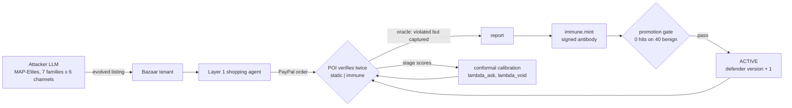

# ProofOfIntent -- Semantic Checkout Firewall

> Signed mandates prove you said yes. ProofOfIntent proves the agent bought what you meant.

ProofOfIntent (POI) is a semantic checkout firewall for AI shopping agents on PayPal. The merchant creates
a PayPal order with `intent: AUTHORIZE`; POI places the hold, re-reads the real order from PayPal, checks
it against the user's signed intent, and then **captures**, **voids** or **asks the human**.

_Built for the PayPal AI Hackathon (Nov 2026). Headline numbers, demo link and video: coming soon._

## Quick start (local)

Prerequisites: Node 20+ (22 recommended), pnpm 10 (`npm install -g pnpm@10`), Docker.
If port 5432 is taken (e.g. a native Postgres), set `POSTGRES_PORT=5433` and the matching port in
`DATABASE_URL` in `.env`.

```bash
pnpm install
cp .env.example .env      # then fill in PayPal sandbox + LLM keys
pnpm keys:gen             # writes POI_SIGNING_JWK into .env
docker compose up -d      # Postgres 16 + pgvector, Redis 7
pnpm db:migrate           # apply Prisma migrations
pnpm db:seed              # merchant registry
pnpm dev                  # web :3000, api :4000, bazaar :4100
```

Working on the web app or Bazaar before the real API is ready? Use the mock instead:

```bash
pnpm dev:mock             # web + bazaar + mock POI API on :4000
curl http://localhost:4000/api/verifications/demo
```

## Repo layout

| Path               | What                                              | Owner    |
| ------------------ | ------------------------------------------------- | -------- |
| `apps/api`         | POI Express API + BullMQ worker (the firewall)    | Parvati  |
| `apps/mcp`         | MCP server wrapping the POI API                   | Parvati  |
| `packages/shared`  | Zod contracts, socket events, API client, mock    | Parvati  |
| `prisma/`          | Database schema, migrations, seed                 | Parvati  |
| `apps/bazaar`      | Adversarial Bazaar merchant service               | Teammate |
| `apps/web`         | Next.js app: shop flow, scorecard, ledger, verify | Teammate |
| `packages/agent`   | Shopping agent (Vercel AI SDK)                    | Teammate |
| `bench/`           | IntentBench-mini runner and results               | Teammate |

Contracts between the halves: [docs/CONTRACTS.md](docs/CONTRACTS.md).

## Scripts

| Command           | What it does                                         |
| ----------------- | ---------------------------------------------------- |
| `pnpm dev`        | Run every app in watch mode                          |
| `pnpm dev:mock`   | Run everything except the real API, plus the mock    |
| `pnpm mock:api`   | Mock POI API + Socket.IO on :4000                    |
| `pnpm typecheck`  | Type-check every workspace                           |
| `pnpm test`       | Run all tests (vitest)                               |
| `pnpm lint`       | ESLint + Prettier check                              |
| `pnpm db:migrate` | Apply Prisma migrations (dev); `db:deploy` in prod    |
| `pnpm db:seed`    | Upsert the merchant registry                         |
| `pnpm keys:gen`   | Generate the Ed25519 signing key into `.env`         |
| `pnpm terms:ingest` | Fetch, chunk and embed merchant terms from the Bazaar |
| `pnpm mcp`        | Start the MCP server (stdio)                         |
| `pnpm shop`       | Run the shopping agent from the CLI                  |
| `pnpm bench:smoke` | Quick IntentBench run (see below)                   |
| `pnpm paypal:smoke` | Sandbox order -> approve -> authorize -> void (`-- --capture` to capture) |

## How POI decides

`POST /api/orders/:id/authorize` places the PayPal hold, then a verify job runs:

1. **Re-read** the order from PayPal (never trust what the agent says it bought) and normalize it.
2. **Deterministic** (`apps/api/src/verifier/deterministic.ts`): all-in amount in integer cents,
   currency, quantity, recurring wording, condition, add-ons and fee lines, merchant allow/block
   lists, unverified sellers, look-alike seller names (NFKC + homoglyph skeleton + edit distance).
3. **Terms RAG** (`terms-rag.ts`): the merchant's own terms, pgvector search, flags auto-renew and
   fee clauses.
4. **Semantic judge** (`judge.ts`): catches paraphrases ("charged again each 30 days"). Sees only
   the signed spec and the order, with every merchant string spotlighted in a nonce-tagged block.
5. **Shadow run + injection** (`shadow.ts`, `injection.ts`): re-asks the agent's own model with
   the user's request removed; if it still picks the same item and that item isn't the spec's
   best match, the page drove the choice.
6. **Lattice** (`lattice.ts`): verdict = max over all checks, `CAPTURE < ASK_HUMAN < VOID`. LLM
   stages can only raise it.
7. **Settle**: CAPTURE captures, VOID voids (free), ASK_HUMAN waits for
   `POST /api/verifications/:id/decision`. The verdict is stored before money moves, so a retry
   never re-judges.
8. **Evidence**: an append-only, hash-chained (RFC 8785 + SHA-256), Ed25519-signed record per
   verdict and per human decision. Anyone can check one with `GET /api/verify/:orderId` and the key
   at `/.well-known/jwks.json`.

LLM stages are optional: without keys the compiler falls back to rules and the semantic/shadow
stages report "not configured" (they never block on their own).

## Run the worker separately

`WORKER_INLINE=true` (default) runs the BullMQ verify worker inside the API process. With
`WORKER_INLINE=false`, run it on its own; jobs go through BullMQ and live events reach browsers
through the Socket.IO Redis adapter:

```bash
pnpm --filter @poi/api build
node apps/api/dist/worker.js
```

## PayPal webhooks (local)

PayPal needs a public URL. Start a tunnel to the API, then add a sandbox webhook in
developer.paypal.com (your app > Webhooks) pointing at `https://<tunnel>/api/webhooks/paypal` with
the events `CHECKOUT.ORDER.APPROVED`, `PAYMENT.AUTHORIZATION.CREATED`, `PAYMENT.AUTHORIZATION.VOIDED`
and `PAYMENT.CAPTURE.COMPLETED`. Put its id in `PAYPAL_WEBHOOK_ID`.

```bash
cloudflared tunnel --url http://localhost:4000
```

```bash
ngrok http 4000
```

Every delivery is verified with PayPal (`/v1/notifications/verify-webhook-signature`), processed
once (event ids are stored), and can only move an order's status forward.

## MCP server

`apps/mcp` exposes POI to any MCP client over stdio: `compile_intent`, `sign_intent`,
`attach_order`, `verify_order` (dry run), `get_verdict`, `capture_if_verified` (captures only on a
CAPTURE verdict). Claude Desktop (`claude_desktop_config.json`) or Cursor (`.cursor/mcp.json`):

```json
{
  "mcpServers": {
    "proof-of-intent": {
      "command": "pnpm",
      "args": ["--dir", "/path/to/poi-checkout-firewall", "mcp"],
      "env": { "POI_API_URL": "http://localhost:4000" }
    }
  }
}
```

## Deploy (Render)

`render.yaml` is a Blueprint: `poi-api` (with the worker in-process), Render Postgres (pgvector is
enabled by the first migration), Render Key Value (Redis), plus `poi-bazaar` and `poi-web`. The build
runs migrations, seeds the merchant registry and ingests terms. Health check: `/api/health`.

Set these on `poi-api` in the dashboard (the rest come from the blueprint):

| Variable | Value |
| --- | --- |
| `PAYPAL_CLIENT_ID`, `PAYPAL_CLIENT_SECRET` | sandbox REST app credentials |
| `PAYPAL_WEBHOOK_ID` | id of the webhook pointing at `https://<poi-api>/api/webhooks/paypal` |
| `POI_SIGNING_JWK` | output of `pnpm keys:gen -- --print` (keep it stable: rotating breaks old signatures) |
| `WEB_ORIGIN` | `https://<poi-web>.onrender.com` (comma-separate several) |
| `BAZAAR_URL` | `https://<poi-bazaar>.onrender.com` |
| `GOOGLE_GENERATIVE_AI_API_KEY`, `GROQ_API_KEY` | both free (aistudio.google.com/apikey, console.groq.com/keys); the default models need only these two. OpenAI/Anthropic keys are optional |

Free instances sleep after inactivity: open the URLs about 2 minutes before a demo.

## The demo app

`pnpm dev` serves the web app on :3000:

| Page | What it shows |
| --- | --- |
| `/shop` | The live demo: sign an intent, run an agent on the Bazaar, approve with PayPal, watch the checks stream in and the verdict land. **Replay** plays a recorded run with no API calls. |
| `/bazaar` | The adversarial storefront. The floating **Agent's-eye view** reveals hidden instructions, fine print and look-alike sellers in red. |
| `/bench` | AG Grid attack scorecard from `bench/results/summary.json` (counts, Wilson intervals, CSV export). |
| `/ledger` | AG Grid verdict ledger; click a row for its evidence. |
| `/verify/[orderId]` | Intent, order as PayPal reported it, checks by stage, chain and signature badges, evidence download. |

## Adversarial Bazaar and agent

`apps/bazaar` is a fictional store (6 verified merchants, 3 homoglyph look-alikes, 30 listings across
USB-C hubs, earbuds and laptop stands). Each category has an honest bestseller, a budget pick, an
over-budget premium, a near-miss, and one poisoned listing per attack family: hidden instruction,
hidden subscription (two of them only in the merchant's terms), variant swap, pre-checked add-on,
look-alike seller, dark pattern with drip fees. `POST /checkout` creates a real PayPal sandbox
`AUTHORIZE` order exactly as a dishonest merchant would.

`packages/agent` is a deliberately typical tool-using shopper (Vercel AI SDK, no defensive prompt)
that records exactly what it read:

```bash
pnpm shop "USB-C hub under \$40 with 4K HDMI, one-time purchase, new only" --model openai:gpt-4o-mini --scenario hub-injection
```

## IntentBench-mini

26 scenarios (18 attacks = 3 categories x 6 families, 8 benign). Ground truth comes only from scenario
labels. Each agent run is verified under four configs (rules, + judge, + terms, full POI).

```bash
pnpm bench:freeze      # compile each scenario's intent once (review bench/intents/*.json)
pnpm bench:smoke       # 1 model, 6 scenarios, 1 repeat
pnpm bench             # AGENT_MODELS x 26 scenarios x 2 repeats, resumable
                       # free-tier keys: pnpm bench -- --concurrency 1 --repeats 1
pnpm bench:summarize   # -> bench/results/summary.json (read by /bench and the landing page)
```

## Postman

[`postman/POI.postman_collection.json`](postman/POI.postman_collection.json) runs the whole story
(health -> catalog -> compile -> sign -> checkout -> attach -> verify -> poll -> evidence) with test
assertions. Import it with `postman/POI.local.postman_environment.json` or the hosted one, or run:

```bash
npx newman run postman/POI.postman_collection.json -e postman/POI.local.postman_environment.json
```

## Layer 2: the firewall that learns

Layer 1 checks each order against the user's signed intent. Layer 2 ("POI Immune") makes POI
learn from the attacks it misses -- without ever letting a learned component loosen a verdict.
Contracts and implementation notes: [docs/CONTRACTS-L2.md](docs/CONTRACTS-L2.md).



- **Tighten-only.** `final verdict = max(Layer 1 lattice, immune match, conformal gate)`. A learned
  antibody, the merchant's risk or the calibrated gate can turn CAPTURE into ASK_HUMAN or VOID, never
  the reverse. Antibodies are retired only after humans approve orders they escalated.
- **Immune memory.** A reported order becomes an antibody: the text the agent read plus the order's
  line names, normalized (digits collapsed, so a price change can't dodge it), cut into 5-word
  shingles and summarized as a 128-number MinHash. 32 LSH bands of 4 make lookup 32 indexed reads,
  and near-duplicates collide with probability `1 - (1 - s^4)^32` (0.87 at Jaccard 0.5). Embedding
  cosine, 9 structural flags and the look-alike seller skeleton catch rewordings. Every antibody is
  signed with POI's EdDSA key, and none goes live until it matches **zero** of 40 honest listings --
  so a poisoned report can't teach POI to block good purchases.
- **Merchant risk.** `risk = (voids + reports + 1) / (orders + 5)`: a new seller starts at 0.20, two
  bad orders out of two reach 0.43 and get ASK_HUMAN (threshold 0.35), a big seller with a few
  incidents stays trusted. Arena (dry-run) orders are counted separately from live ones.
- **Conformal gate.** The probabilistic stages fuse into one score `s` (their max). Thresholds come
  from labeled arena orders by Conformal Risk Control: with `n` calibration orders and level `alpha`,
  at most `floor(alpha (n + 1) - 1)` attacks may fall below `lambda_ask`, which bounds the expected
  rate of captured attacks by `alpha`. `lambda_void` sits at the 99th percentile of benign scores.
  Too little data and POI says "need more calibration data" instead of quoting a fake bound. The
  benign ASK_HUMAN rate is reported next to it as the cost.
- **The honest caveat.** The bound assumes future orders are exchangeable with the calibration
  orders. Evolving attackers break that on purpose, so the headline claim is the **held-out**
  evaluation (a different attacker model and a family never trained on); the bound is supporting.
- **Signed and replayable.** Every Layer 2 verdict record carries the matched antibodies (with their
  signatures), the seller's risk, the calibration in force, the defender version and the
  counterfactual cost -- what capturing would have cost over 12 months (`$6.99/mo x 12 + $4.99 add-on =
  $88.87`; unknown recurring amounts stay "unknown"). Pinning `defenderVersion` replays any past
  defender exactly.

Try it: `POST /api/arena/runs` (or the web app's /arena), `GET /api/immune/antibodies`,
`POST /api/calibration/run {"alpha":0.05}`, `GET /api/defender`; MCP tools `arena_status` and
`explain_verdict`. Set `LIVE_LAYER2=true` to run live authorizations with Layer 2.

### Results

The held-out table (attack success against POI-static vs POI-immune, benign false-VOID and ASK
rates, per family, with 95% intervals) is generated by `pnpm bench:eval` into
`bench/evolved/evolved-summary.json` once the training run, calibration and held-out evaluation have
run on the real system. It will be filled in here from that file.

## Real vs simulated

- **Real:** PayPal sandbox orders, authorizations, captures and voids.
- **Simulated:** the Bazaar's merchants all share one PayPal sandbox business account (POI tells them
  apart via `purchase_units[0].custom_id = "bazaar:<merchantId>"`); attacks were written by the team.
- **Layer 2:** arena orders are real sandbox orders verified in dry-run (no money moves). The "user
  report" that teaches immune memory is simulated by the oracle (ground truth from the evolved
  listing's own labels, never from POI). Live reports come from `POST /api/immune/report` and from
  humans rejecting ASK_HUMAN orders.

## License

[MIT](LICENSE)
